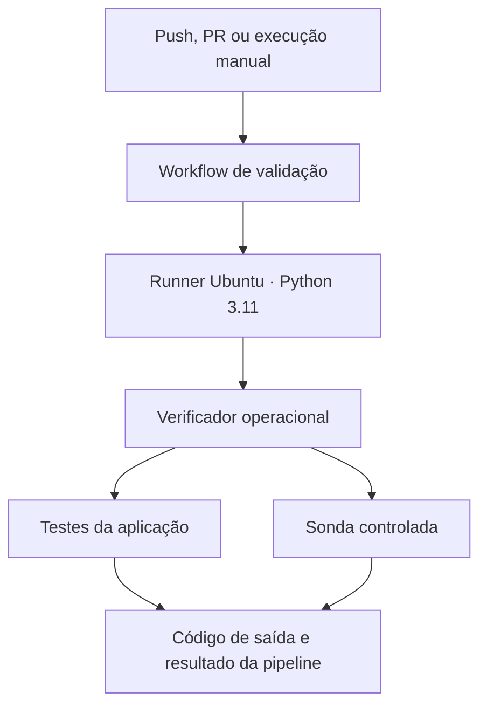
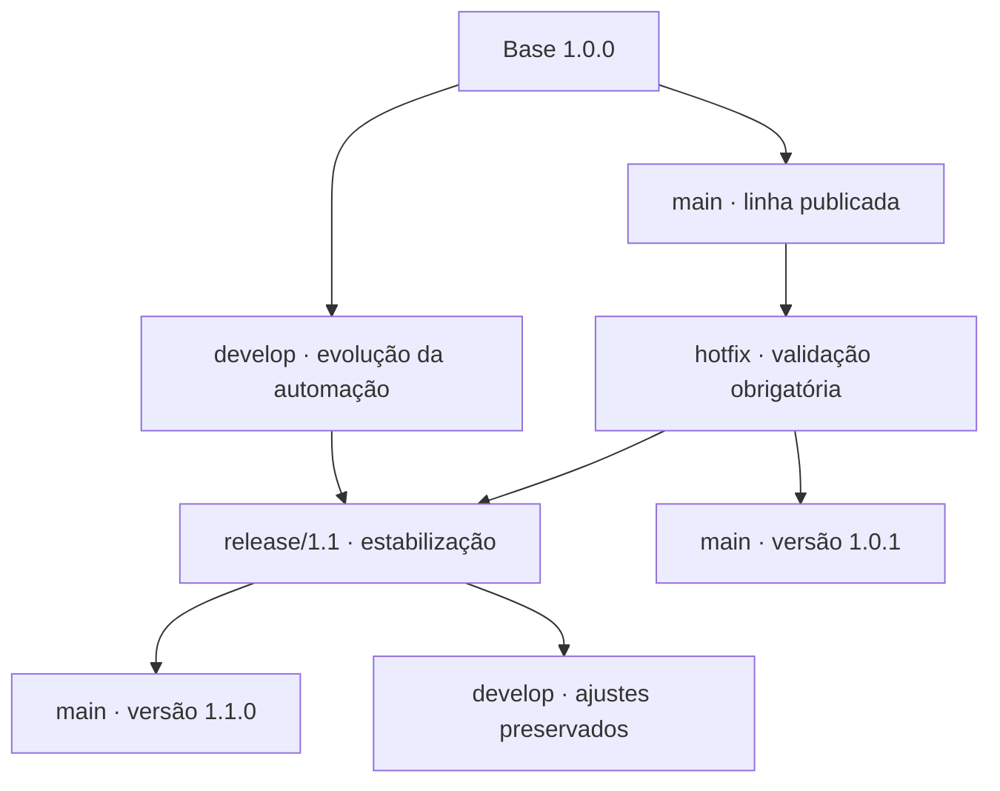

# 02 · Corrigir uma pipeline enquanto prepara a próxima release

[Organização Jardim de Plataforma](https://github.com/jardim-plataforma) · [Repositório do laboratório](https://github.com/jardim-plataforma/lab-02-release-e-correcao)

## Contexto

Um serviço de catálogo já está implementado. Ele possui uma API, um portal, dados de demonstração e testes. A equipe de plataforma mantém a automação que verifica esse serviço e prepara sua distribuição. Você assume a manutenção dessa automação; os contratos e as funcionalidades da aplicação estão fora da mudança planejada.

A linha publicada do laboratório é a 1.0.0. Ela verifica o projeto em Python 3.11, mas ainda não distribui pacotes pela pipeline. A próxima versão, 1.1.0, deve verificar também Python 3.12 e disponibilizar um pacote executável, identificado por versão e commit.

Durante a estabilização da 1.1, uma execução da linha publicada apresenta uma inconsistência: a verificação obrigatória falha, mas a pipeline termina com sucesso. Uma pessoa que olha apenas o resultado geral pode concluir, incorretamente, que a entrega foi validada. Você precisa corrigir essa sinalização sem antecipar o empacotamento ainda em avaliação. A próxima versão também precisa preservar a correção.

O cenário é fictício. A falha controlada é uma sonda de diagnóstico: provoca um retorno não zero sem alterar a aplicação. O defeito a investigar está na forma como a automação trata esse retorno.

## Objetivo da entrega

Entregar a versão corretiva 1.0.1 e concluir a evolução 1.1.0, demonstrando que uma verificação obrigatória reprovada bloqueia a entrega. O trabalho envolve leitura de YAML, diagnóstico de jobs e steps, dependências entre jobs, artefatos, rastreabilidade e recuperação, organizado por Git Flow.

A métrica principal é comportamental: a mesma falha precisa produzir resultados diferentes antes e depois da correção. O nome de um commit ou a existência de branches não comprovam a solução.

## Ponto de partida

Use Git, Python 3.11 local e GitHub Actions com runners hospedados Ubuntu. A matriz de CI deve testar Python 3.11 e 3.12. Python 3.12 local é opcional. Não há dependências Python externas, credenciais cloud, Docker, registry ou cluster nesta etapa. A execução local usa apenas localhost.

É necessário poder executar workflows no repositório. A execução manual aparece quando o arquivo do workflow existe na branch padrão. Restrições de Actions da conta ou organização podem impedir execuções; isso é uma condição do ambiente, não evidência de defeito na aplicação.

A publicação deste laboratório significa uma versão identificada por tag e notas no GitHub; na 1.1, inclui o pacote produzido pela execução dessa tag. Não há deploy em produção. Um artefato do Actions também não se transforma automaticamente em um anexo de GitHub Release.

## Sistema existente

O README do repositório apresenta os arquivos e os comandos. O serviço e seus testes vêm da revisão identificada em `docs/origem.md`. As ferramentas operacionais estão prontas: você fará a integração delas no workflow, sem precisar programar o empacotador.

## Contrato da próxima versão

A 1.1 deve verificar o projeto em Python 3.11 e 3.12. Apenas quando todas as verificações obrigatórias passarem, um job separado poderá produzir, conferir e disponibilizar o ZIP de entrega. Use um nome de artefato que permita reconhecer a versão e a execução. Guarde relatórios de diagnóstico separadamente, se desejar; relatórios de uma falha não são pacotes liberados para entrega.

O ZIP deve conter somente `backend/`, `frontend/`, `VERSION`, `EXECUTAR.md` e `release.json`. O manifesto identifica a versão e o SHA completo dos arquivos empacotados. A versão deve coincidir com `VERSION`; o SHA deve corresponder ao checkout efetivamente utilizado. Em PRs, a revisão testada pode ser o commit de merge de teste criado pelo GitHub, não o último commit isolado da branch.

Na tag final `v1.1.0`, o pacote precisa declarar `1.1.0` e o commit apontado pela tag. Não renomeie um pacote de release candidate para fingir que ele foi construído da versão final. O pacote candidato pode usar `1.1.0-rc.1`.

A ferramenta `tools/check_package.py` extrai o ZIP numa pasta temporária, inicia o serviço a partir dessa cópia e verifica saúde, contratos, respostas de ausência e arquivos do portal. Ela também confere os metadados. Isso testa a execução sem depender do checkout original; não equivale a uma validação completa de produção.

## Desenvolvimento da demanda

### 1. Reconhecer a linha publicada

Comece com a versão inicial em `main`, identificada por `v1.0.0`. Execute o cenário normal e conheça o caminho entre evento, runner, comando e resultado. Identifique a responsabilidade de cada arquivo antes de editar. Não altere os contratos da API nem enfraqueça seus testes.

A versão 1.0.0 é uma referência do laboratório com uma limitação conhecida, não uma recomendação de pipeline para outros projetos.

### 2. Preparar a evolução em develop

Crie `develop` a partir da principal. Trabalhe em uma branch de melhoria e abra um PR para `develop`. Adicione a matriz e conecte as ferramentas prontas ao workflow. Use `VERSION` com um identificador candidato, como `1.1.0-rc.1`. A mudança é operacional: YAML, configuração de entrega e documentação.

Quando o conjunto da versão estiver integrado, abra `release/1.1` a partir de `develop`. Ela será a candidata em estabilização. Ainda será necessário verificar o pacote baixado e o bloqueio de entrega em caso de falha. A branch pode existir enquanto esses critérios estão pendentes.

### 3. Investigar o incidente na linha atual

Volte à linha publicada e execute manualmente o cenário `falha`. Compare os logs, o resultado da etapa e a conclusão geral. Reproduza localmente o mesmo cenário e examine o código de saída. Registre a hipótese e o ponto em que o resultado deixa de representar a verificação real.

Crie `hotfix/validacao-obrigatoria` a partir de `main`, ainda na linha 1.0. Não parta da release: ela contém o trabalho futuro. Corrija a automação e ajuste `VERSION` para `1.0.1`. Preserve a sonda de falha e os testes. A corretiva não pode incluir a matriz nova nem o job de empacotamento.

Abra um PR para `main`, compare o escopo e valide normal e falha. A execução reprovada de propósito é uma evidência esperada, não algo a esconder. Depois de integrar, confira novamente o estado da principal, marque `v1.0.1` e registre notas da correção. Use revisão própria identificada como tal se estiver estudando individualmente.

### 4. Incorporar a correção à release

A correção precisa alcançar `release/1.1`. Resolva conflitos pela intenção: a release precisa manter a evolução e receber a correção. `VERSION` pode conflitar porque as linhas identificam entregas diferentes; a release continua candidata a 1.1, não vira 1.0.1.

Valide `normal`, `falha` e `falha-python312`. No último cenário, apenas Python 3.12 deve reprovar a sonda. Isso permite comprovar que a aprovação de Python 3.11 sozinha não libera o pacote. Não avalie o caso apenas pela existência de um commit de hotfix.

### 5. Concluir e publicar a versão planejada

Finalize as verificações da candidata, ajuste `VERSION` para `1.1.0` e integre a release em `main`. Valide o commit integrado antes de marcá-lo. Execute a tag final, baixe o artefato e confira o pacote com o commit real da tag.

Publique as notas de `v1.1.0` e anexe o ZIP verificado, extraído do contêiner ZIP do artefato do Actions se necessário. Não reconstrua um arquivo diferente para anexar. Leve os ajustes de estabilização da release de volta a `develop`, preservando eventuais mudanças futuras. Documente os destinos da correção e os commits finais.

### 6. Ensaiar recuperação

Imagine que o empacotamento da 1.1 apresente um problema. Em uma branch `recovery/...`, demonstre um caminho para recuperar o comportamento corrigido da 1.0.1 sem reintroduzir o falso sucesso da 1.0.0. A escolha pode envolver reversão de mudanças ou retomada explícita de uma referência verificada; explique o impacto.

Teste a sonda de falha na recuperação. Não reescreva a principal com reset forçado e não mova tags publicadas. O ensaio pode permanecer em uma branch e PR sem ser incorporado. Recuperar a automação não significa restaurar automaticamente um serviço em produção.

## Como as linhas se relacionam

| Linha | Responsabilidade | Destino das alterações |
|---|---|---|
| `main` | Linha publicada neste exercício | Origina hotfix e recebe versões verificadas |
| `develop` | Integração da evolução | Origina a release e recebe seus ajustes finais |
| `release/1.1` | Estabilização do conjunto escolhido | Recebe a correção, retorna a main e develop |
| `hotfix/validacao-obrigatoria` | Correção mínima da linha 1.0 | Alcança main e a release ativa |

As branches não são ambientes. Elas não precisam ter o mesmo conteúdo: main pode conter a correção sem a evolução, enquanto a release contém as duas. É necessário preservar a correção onde ela importa, não tornar todas as linhas idênticas.

## Incidente para investigar

Há dois níveis de investigação: o comando reprovou, mas a execução ficou verde; depois, na candidata, uma versão de Python reprovou e ainda assim pode ter sido liberado um pacote. Diferencie o tratamento da falha dentro do job da dependência entre os jobs. A correção só está completa quando o resultado geral e a disponibilidade da entrega correspondem às verificações obrigatórias.

Examine os logs e os estados reais antes de escolher uma alteração. Um resumo textual dizendo “falhou” não corrige um workflow que continua liberando a entrega.

## Critérios de conclusão

| Referência | Cenário normal | Cenário de falha | Pacote pela pipeline |
|---|---|---|---|
| `v1.0.0` | Sucesso | Falso sucesso a investigar | Não há |
| `v1.0.1` | Sucesso | Falha corretamente | Não há |
| `v1.1.0` | Sucesso nas duas versões | Falha e bloqueio do pacote | Somente após sucesso obrigatório |

- A correção mínima não antecipa a evolução em 1.0.1.
- A 1.1 preserva a correção e não libera o pacote quando apenas Python 3.12 falha.
- Versão, tag, commit testado, execução e manifesto do pacote são coerentes.
- O pacote baixado funciona isoladamente e não contém testes, ferramentas, caches ou dados do Git.
- PRs e notas permitem compreender o que foi entregue e as limitações das verificações.
- O ensaio de recuperação mantém a verificação obrigatória funcionando.
- Os ajustes finais chegam a develop. As tags permanecem estáveis.

As evidências devem relacionar referência Git, cenário executado, URL da execução e resultado observado. Inclua o comando e resultado da verificação do pacote baixado. Registre hipóteses descartadas quando forem relevantes para explicar o diagnóstico. Não há necessidade de preencher campos vazios no site: acrescente sua resolução quando houver conteúdo.

## Progressão de aprendizado

O Lab 1 praticou compatibilidade e integração de propostas. Aqui, o foco é manter uma automação confiável durante duas frentes de entrega. Git Flow organiza essas frentes; YAML e Actions materializam a operação. Trunk-Based será comparado depois, por meio de incrementos menores e integração frequente, sem repetir este mesmo roteiro com nomes diferentes.

## Referências

- [Modelo Git Flow](https://nvie.com/posts/a-successful-git-branching-model/)
- [Sintaxe de workflows](https://docs.github.com/en/actions/reference/workflows-and-actions/workflow-syntax)
- [Artefatos do GitHub Actions](https://docs.github.com/en/actions/tutorials/store-and-share-data)
- [Execução manual de workflows](https://docs.github.com/en/actions/how-tos/manage-workflow-runs/manually-run-a-workflow)
- [Criar uma GitHub Release](https://docs.github.com/en/repositories/releasing-projects-on-github/managing-releases-in-a-repository)
